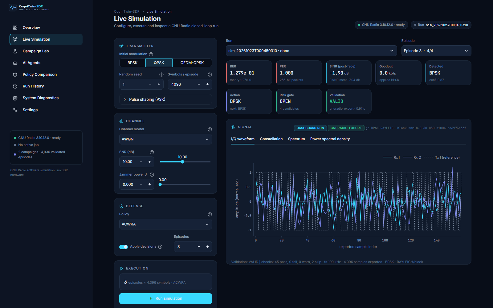
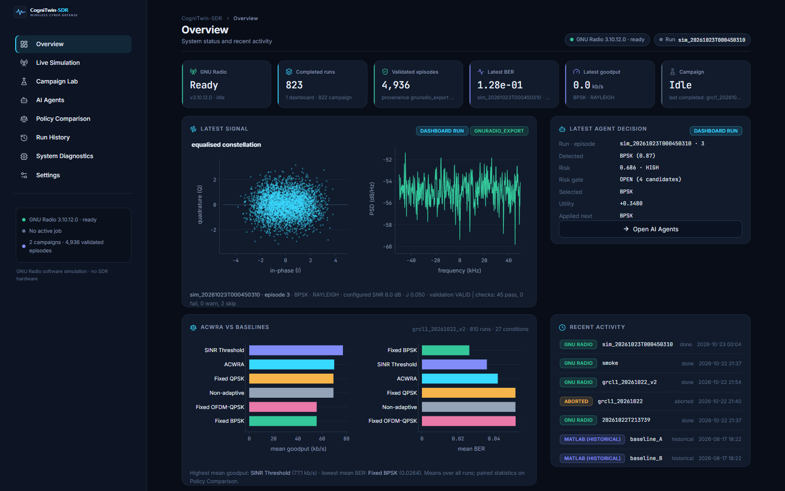
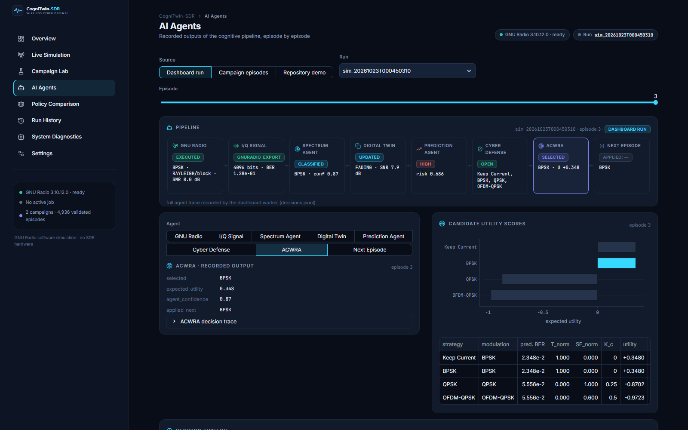
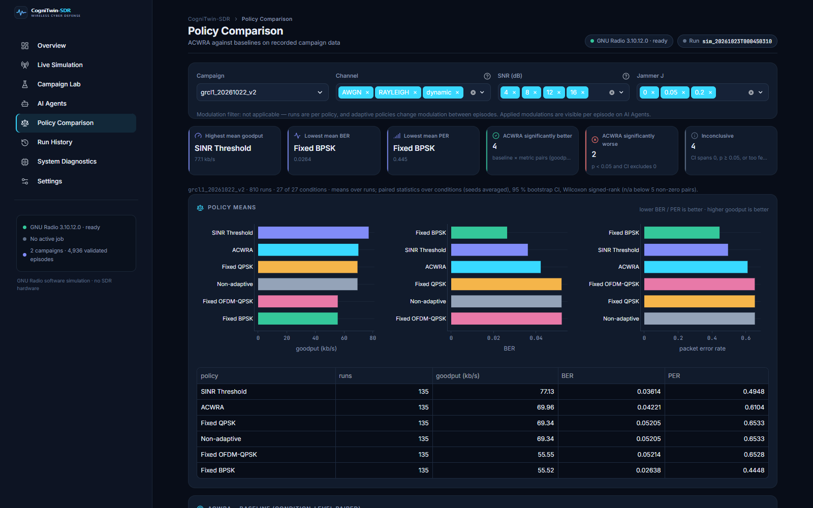

<div align="center">


# CogniTwin-SDR

**Agentic Cognitive Digital Twin for Autonomous Wireless Cyber Defense**

[](https://github.com/dhirenv-21/CogniTwin-SDR/actions/workflows/tests.yml)
[](LICENSE)


</div>

A software-only research platform: a **GNU Radio 3.10** physical layer (BPSK, QPSK, OFDM-QPSK
over AWGN, Rayleigh/Rician fading and a jammer) feeds a multi-agent pipeline (**Spectrum
Agent → Digital Twin → Prediction Agent → Cyber Defense Agent**) and the **ACWRA** decision engine,
which reconfigures the link episode by episode. Every result is validated and labelled with its
provenance. No SDR hardware is needed, and nothing is transmitted over the air.



## ✨ Highlights

- **Real GNU Radio PHY**: flowgraph with RRC shaping, fading, noise and jammer branches measured separately; BER validated against theory (18/18 points within CI).
- **Cognitive pipeline**: Random-Forest modulation classifier + blind SNR, a digital twin with counterfactual evaluation, risk prediction, a risk-gated candidate set and multi-objective ACWRA utility scoring.
- **Closed-loop campaigns**: 27 conditions × 5 seeds × 6 policies = 4,860 GNU Radio episodes (`results/gnuradio/campaign/grcl1_20261022_v2`), with condition-level paired statistics (bootstrap CI, Wilcoxon).
- **Honest results**: in that campaign an a-priori SINR-threshold rule beats ACWRA on goodput and BER; the dashboard and reports show the data as measured.
- **Control dashboard**: eight-page Streamlit workbench to run simulations and campaigns and to inspect signals, agent decisions, policy comparisons and run provenance.

<table>
<tr>
<td></td>
<td></td>
</tr>
<tr>
<td align="center"><b>Overview</b></td>
<td align="center"><b>AI Agents</b>: per-episode pipeline and ACWRA utility scores</td>
</tr>
<tr>
<td colspan="2"></td>
</tr>
<tr>
<td colspan="2" align="center"><b>Policy Comparison</b>: recorded campaign means and paired statistics</td>
</tr>
</table>

## 🚀 Quick start

```bash
git clone https://github.com/dhirenv-21/CogniTwin-SDR.git
cd CogniTwin-SDR
pip install -r requirements.txt
python dashboard/run_dashboard.py        # http://localhost:8501
```

Without GNU Radio the dashboard is browse-only: every recorded result is available and the run buttons
explain why they are disabled. To execute simulations, create the GNU Radio environment once (see
[Control Dashboard](#️-control-dashboard)); the launcher then switches to it automatically.

---

## 📁 Repository Layout

```
cognitwin-sdr/
├── src/
│   ├── signal/            generation, I/Q, AWGN, FFT/PSD, filters, blind SNR estimator (estimate_snr_blind)
│   ├── modulation/        analog (AM/FM/PM/SSB) and digital (ASK/FSK/PSK) modulators
│   ├── multicarrier/      OFDM and MIMO
│   ├── channel/           AWGN channel wrapper
│   ├── ai/                modulation classifier: features, dataset, Random Forest, analyze_iq()
│   ├── virtual_rf/        scenario-driven virtual RF environment (also the twin's link model)
│   ├── digital_twin/      Cognitive Digital Twin: state, history, trend predictor, counterfactual sandbox
│   ├── agents/            Spectrum, Prediction and Cyber Defense agents + orchestrator
│   ├── acwra/             ACWRA multi-objective decision engine
│   ├── simulink_bridge/   MAT-file receiver, validation/provenance, Simulink -> ACWRA pipeline, reference PHY
│   ├── gnuradio_phy/      GNU Radio 3.10 flowgraph, receiver, NPZ export + provenance, episode closed loop
│   └── evaluation/        metrics
├── simulink/              MATLAB/Simulink PHY model generator, drivers, diagnostics, exports (see simulink/README.md)
├── grc/                   GNU Radio Companion visual demo (cognitwin_phy_demo.grc)
├── experiments/           demos, campaigns and evaluation scripts
├── results/               generated figures, models and evaluation outputs
├── config/scenarios/      virtual-RF scenario keyframes (JSON)
├── docs/                  design notes per subsystem
├── tests/                 pytest suite
├── dashboard/             Streamlit control dashboard (app shell, views/, ui/ design system, worker)
└── docs/reports/          session log, test report, GNU Radio integration and completion reports, MATLAB handoff
```

---

## 🔁 Data flow

```
MATLAB/Simulink PHY (cognitwin_sdr_phy.slx)          VirtualRFEnvironment (Python)
  run_simulink_case -> MAT export                       step() -> EnvironmentState + I/Q
        |                                                      |
SimulinkReceiver.load_and_validate()                           |
  schema, finiteness, consistency, provenance                  |
        |                                                      |
SimulinkACWRAPipeline.run_measurement()      MultiAgentOrchestrator.step()
        \______________________________________________________/
                                   |
   SpectrumAgent (analyze_iq: classifier + blind SNR) -> DigitalTwin.update()
   -> PredictionAgent (trend forecast, risk) -> CyberDefenseAgent (candidates)
   -> ACWRAEngine.evaluate_and_decide() using DigitalTwin.evaluate_counterfactuals()
                                   |
            ACWRADecision (+ trace); closed loop applies it via
            VirtualRFEnvironment.modulation_override (experiments/closed_loop_evaluation.py)
```

Provenance classes (src/simulink_bridge/validation.py `classify_provenance`): a file is a
**real Simulink export** only if its MAT header shows MATLAB wrote it AND `source = 'simulink'`.
Python-written files (`Platform: nt` header), fixtures (`source = 'python-fixture'`) and
synthetic data are never labelled real. `load_and_validate(require_real=True,
require_model_version="v4", not_before=<time>)` enforces this and rejects stale files.

---

## ⚡ Quick Start

```bash
python -m venv venv
venv\Scripts\activate                    # Linux/macOS: source venv/bin/activate
pip install -r requirements-lock.txt     # exact versions used for the committed results
python -m pytest -q                      # Python test suite
python experiments/review_demo.py        # review demo: real (historical v3) Simulink export ->
                                         # agents -> Digital Twin -> ACWRA, then a short virtual-RF loop
python experiments/review_demo.py --fixture   # same with a labelled Python fixture
python experiments/reproduce_python_results.py --quick   # re-run evaluations into new folders and compare
```

Documentation: [`docs/ARCHITECTURE.md`](docs/ARCHITECTURE.md) ·
[`docs/acwra_algorithm.md`](docs/acwra_algorithm.md) (ACWRA specification) ·
[`docs/DATA_SCHEMA_PROVENANCE.md`](docs/DATA_SCHEMA_PROVENANCE.md) ·
[`docs/EXPERIMENT_PROTOCOL.md`](docs/EXPERIMENT_PROTOCOL.md) ·
[`docs/REPRODUCIBILITY.md`](docs/REPRODUCIBILITY.md) ·
[`results/evaluation/RESEARCH_EVALUATION.md`](results/evaluation/RESEARCH_EVALUATION.md) ·
[`docs/reports/MATLAB_HANDOFF.md`](docs/reports/MATLAB_HANDOFF.md) · [`docs/reports/FINAL_COMPLETION_REPORT.md`](docs/reports/FINAL_COMPLETION_REPORT.md)

---

## 🚀 Running the Signal Foundation Demonstration

To execute the end-to-end signal generation, I/Q conversion, AWGN noise injection, FIR filtering, FFT spectrum analysis, metric calculation, and visualization pipeline:

```bash
python main.py
```

### Outputs
- Console execution logs and metric calculations (Frequency, SNR improvement, Bandwidth).
- Diagnostic plot saved to `results/signal_foundation_demo.png` containing:
  1. **Panel 1**: Time domain real/quadrature waveforms (Clean vs Noisy vs Filtered).
  2. **Panel 2**: Complex I/Q Constellation / Trajectory ($I$ vs $Q$).
  3. **Panel 3**: FFT Spectrum before filtering (Signal + AWGN noise floor).
  4. **Panel 4**: FFT Spectrum after FIR filtering (Suppressed out-of-band noise).

---

## 📡 MATLAB/Simulink Physical Layer

The physical layer (BPSK / QPSK / OFDM-QPSK through AWGN, block Rayleigh/Rician fading
and a Gaussian jammer) is simulated in Simulink and exported to MAT files for the
Python agents. See [`simulink/README.md`](simulink/README.md) for building the model
(`create_cognitwin_model`), diagnostics (`diagnose_simulink_phy`), single runs
(`run_simulink_case`), the export schema and known limitations.

---

## 📻 GNU Radio Physical Layer (executed: PHY validated, closed-loop campaign run)

A second, independent PHY built from GNU Radio 3.10 blocks: BPSK/QPSK with RRC pulse shaping, and
OFDM-QPSK with IFFT and cyclic prefix. The channel is AWGN, block or time-varying Rayleigh/Rician, plus a Gaussian jammer.
Its exports use the bridge schema (NPZ), provenance is decided from evidence (content hash, flowgraph
hash, run ledger), and they feed the unchanged agents and ACWRA, including an episode-based closed loop.
It runs in a separate conda environment (GNU Radio 3.10.12.0). There, all 12 execution tests pass and
measured BER matches theory at 18/18 points. In environments without GNU Radio, the execution tests
skip with the reason and the scripts exit with `BLOCKED`. Setup and resume commands:
[`docs/GNURADIO_SETUP.md`](docs/GNURADIO_SETUP.md); status: [`docs/reports/GNURADIO_INTEGRATION_REPORT.md`](docs/reports/GNURADIO_INTEGRATION_REPORT.md).

---

## 🖥️ Control Dashboard

From the repository root:

```bash
python dashboard/run_dashboard.py
```

Then open <http://localhost:8501> (another port: append `--server.port 8502`).

The launcher checks whether the current Python can import GNU Radio. If not, it relaunches
itself with a GNU Radio conda environment (`cognitwin-gr`, e.g. `D:\micromamba\envs\cognitwin-gr`,
or `$COGNITWIN_GR_PYTHON`), so **Run simulation** works with the same command. Without such an
environment the dashboard is browse-only and says why. To create the environment:

```bash
micromamba create -n cognitwin-gr -c conda-forge python=3.12 numpy=2.2 scipy=1.15 "libblas=*=*openblas" gnuradio=3.10.12 scikit-learn=1.7.2 matplotlib joblib pytest pyyaml streamlit plotly pandas
```

Eight views: Overview, Live Simulation, Campaign Lab, AI Agents, Policy Comparison,
Run History, System Diagnostics and Settings. Set inputs, choose a policy and click
**Run simulation**. GNU Radio runs through the existing backend, and the views show the run's
measured results, signal plots and agent/ACWRA decisions. See [`docs/DASHBOARD.md`](docs/DASHBOARD.md).

---

## 🧪 Tests

```bash
python -m pytest -q
```

All tests are Python; none executes MATLAB. GNU Radio execution tests
(`tests/test_gnuradio_execution.py`) run only where GNU Radio imports and otherwise skip with the reason. Categories, counts and what each proves:
[`docs/reports/AUTONOMOUS_TEST_REPORT.md`](docs/reports/AUTONOMOUS_TEST_REPORT.md).

---

## 🔬 Experiments and evaluation

| command | what it produces | data |
|---|---|---|
| `python experiments/simulink_acwra_demo.py --mat <file> --require-real` | one MAT export through every agent + ACWRA trace | real Simulink if the file is one |
| `python experiments/verify_simulink_mat.py --dir simulink/results/baseline` | independent recomputation of every PHY quantity, cross-seed noise check | real Simulink exports |
| `python experiments/simulink_acwra_campaign.py --source fixture` | 402-check bridge/agent/ACWRA campaign -> `simulink/results/campaign_report/` | Python fixtures |
| `python experiments/retrain_modulation_classifier.py [--check]` | retrains `rf_model_mixed.joblib`, old vs new evaluation -> `results/ai/modulation_classifier/retrain_eval/`; `--check` re-trains in memory and compares, writing nothing | synthetic |
| `python experiments/spectrum_agent_eval.py [--out-dir D]` | confusion, P/R/F1, calibration, blind-SNR error, false SNR_DROP -> `results/ai/spectrum_eval/` | synthetic |
| `python experiments/digital_twin_forecast_eval.py [--out-dir D]` | causal twin forecast vs persistence and alternatives -> `results/digital_twin/forecast_eval/` | virtual-RF |
| `python experiments/closed_loop_evaluation.py [--suite original\|sweep\|all]` | protocol CL-2: ACWRA vs fixed / rules / oracle plus four ablations, paired statistics -> `results/evaluation/closed_loop/<run_id>/` | virtual-RF |
| `python experiments/research_evaluation.py` | consolidated report -> `results/evaluation/RESEARCH_EVALUATION.md` | reads saved outputs only |
| `python experiments/reproduce_python_results.py [--quick]` | re-runs the evaluations into new folders and prints MATCH / DIFFER | all of the above |
| `python experiments/review_demo.py [--mat F \| --fixture]` | one input through every stage, provenance-labelled, then a short virtual-RF loop | as labelled |
| `python experiments/acwra_decide.py --mat F --state S --out D [--require-real]` | one closed-loop decision (called by `simulink/matlab/run_simulink_closed_loop.m`) | as labelled |

MATLAB side: `simulink/README.md` and [`docs/reports/MATLAB_HANDOFF.md`](docs/reports/MATLAB_HANDOFF.md). Before transfer:
`python experiments/handoff_check.py pre`; after the artifacts return: `python experiments/handoff_check.py post`.

---

## ⚠️ Known limitations (summary)

Full status, evidence and acceptance criteria: [`docs/reports/FINAL_COMPLETION_REPORT.md`](docs/reports/FINAL_COMPLETION_REPORT.md).

* **No v4 Simulink run exists.** The committed `.slx` is the v3 build, whose noise ignored the seed.
  D1–D18 (including D13), the v4 baseline and the Simulink closed loop have never executed.
  See `docs/reports/MATLAB_HANDOFF.md`.
* Closed-loop results use the Python virtual-RF link model, which is also the Digital Twin's
  sandbox model (expected fade versus the realised block fade). They measure decision logic,
  not physical-layer performance.
* Under protocol CL-2, ACWRA does **not** beat simple baselines on goodput. In the 30-condition
  sweep the a-priori SINR-threshold rule has more goodput (ACWRA −12.2 kb/s, 1/3/26) **and**
  lower BER. ACWRA's objective is BER-averse by construction; its weights were not tuned.
* Ablations: the classifier-confidence terms change no decision; the Prediction Agent makes ACWRA
  more BER-averse; the risk-gated candidate set costs goodput.
* The twin's degree-1 trend forecast is worse than persistence on step scenarios (alternatives
  evaluated, not adopted).
* Fading: Simulink applies one gain per run; virtual RF applies one gain per 0.1 s block.
  Neither is time-varying within a block.
* The classifier and the blind SNR estimator are evaluated on synthetic signals only.

---

## 🛡️ License & Citation

Released under the [MIT License](LICENSE). Research prototype developed for Autonomous Wireless
Cyber Defense studies; if you use it, please cite it via [`CITATION.cff`](CITATION.cff).
