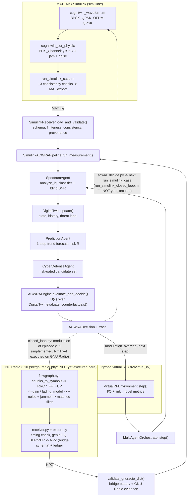

# Architecture

What the code does today (branch `autonomous-completion`). Status words: **implemented**
(code exists), **tested** (Python tests exercise it), **runtime-verified** (executed in
its target environment with recorded evidence).

## End-to-end flow

## Components

| component | files | status |
|---|---|---|
| Simulink PHY v4 | `simulink/create_cognitwin_model.m`, `simulink/matlab/*.m` | implemented; static checks only; **never executed** (no MATLAB here). v3 (older model) has real historical exports |
| Simulink diagnostics D1–D18 | `simulink/matlab/diagnose_simulink_phy.m` | implemented; **not run** |
| Simulink runbook | `simulink/matlab/run_v4_validation.m` | implemented; **not run** |
| Simulink closed loop | `simulink/matlab/run_simulink_closed_loop.m` + `experiments/acwra_decide.py` | implemented; Python side tested on fixture MAT files; MATLAB side **not run** |
| MAT bridge + provenance | `src/simulink_bridge/{receiver,validation,protocol}.py` | implemented, tested; ingestion runtime-verified on real **v3** exports |
| Pipeline | `src/simulink_bridge/pipeline.py` | implemented, tested (fixtures + real v3 exports) |
| Spectrum Agent | `src/agents/spectrum_agent.py`, `src/ai/modulation_classifier/`, `src/signal/analysis.py` | implemented, tested, evaluated on synthetic signals (`results/ai/spectrum_eval/`) |
| Digital Twin | `src/digital_twin/` | implemented, tested; forecasting evaluated (`results/digital_twin/forecast_eval/`) |
| Prediction / Cyber Defense agents | `src/agents/{prediction_agent,cyber_defense_agent}.py` | implemented, tested |
| ACWRA | `src/acwra/` | implemented; hand-calculated tests (`docs/acwra_algorithm.md`) |
| Virtual RF + link model | `src/virtual_rf/{environment,link_model,scenario,interference}.py` | implemented; validated against analytical and Monte-Carlo references (`tests/test_link_model.py`) |
| Closed loop (virtual RF) | `experiments/closed_loop_evaluation.py` | implemented, tested, executed (protocol CL-2) |
| GNU Radio PHY | `src/gnuradio_phy/flowgraph.py`, `grc/cognitwin_phy_demo.grc` | implemented against the GNU Radio 3.10 API; **never executed** (GNU Radio not installed here); execution tests skip |
| GNU Radio export / provenance | `src/gnuradio_phy/{export,validation}.py` | implemented, tested on NumPy stand-ins (labelled fixture / deliberate forgeries) |
| GNU Radio closed loop + campaign | `src/gnuradio_phy/closed_loop.py`, `experiments/gnuradio_*.py` | loop logic tested with a stand-in PHY; GNU Radio runs **not executed** |

## Loops, never conflated

* **Virtual-RF loop** (executed): `VirtualRFEnvironment` ↔ agents ↔ ACWRA, decision
  applied through `modulation_override` with a one-step delay. Every result file says
  "virtual RF (NOT Simulink)".
* **Simulink loop** (implemented, not executed): MATLAB runs one block per step,
  calls `experiments/acwra_decide.py` on the export, and applies the returned modulation to
  the next `run_simulink_case`. The twin's history persists between calls in
  `twin_state.json`.
* **GNU Radio loop** (implemented, not executed): episode-based sequential
  reconfiguration. Each episode is one complete flowgraph run with a frozen
  configuration; the decision computed from episode e sets the modulation of
  episode e + 1 (`src/gnuradio_phy/closed_loop.py`). It is not a streaming loop.

## Semantics that cross module boundaries

* **SNR.** Everywhere it is transmit-referenced Es/N0 *without* interference. The
  Digital Twin and its sandbox add J and the expected fade themselves. The bridge feeds
  the twin P_tx / P_noise measured from `noise_iq` (or the configured SNR, labelled
  `nominal`), never the measured SINR.
* **Interference J.** Power relative to the unit transmit signal, treated by the link model
  as Gaussian noise.
* **Fading.** Simulink applies one complex gain per run (static realisation per export).
  Virtual RF draws one gain per 0.1 s step: block fading, *not* time-varying within a
  block. The twin's sandbox uses the expectation over the fading distribution.
* **Threat label.** `DigitalTwinState.threat_condition` (`BROADBAND_JAMMING`,
  `NARROWBAND_JAMMING`, `FADING`, `NOMINAL`) is a heuristic on the measured interference
  power and channel type. It is an inferred *condition*, not an attribution of an attack.
* **Time.** `EnvironmentState.timestamp_s` is the start of a block. The orchestrator's
  snapshot and ACWRA decision carry the end-of-block time (decision made after the
  observation).
