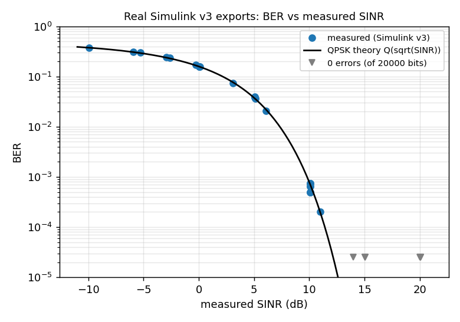

# CogniTwin-SDR research evaluation

Generated by `experiments/research_evaluation.py` from saved outputs only. Data classes: **REAL SIMULINK (historical v3)**, **PYTHON SYNTHETIC**, **PYTHON VIRTUAL RF**, **PYTHON FIXTURES**. No v4 Simulink result exists; nothing here is a v4 measurement, and no virtual-RF number is a physical-layer result.

## 1. Physical layer — REAL Simulink exports, HISTORICAL v3 model

Source: `simulink/results/baseline/baseline_results.csv` (MATLAB R2025a, 2026-08-17, `cognitwin_sdr_phy.slx` v3). 35 QPSK runs; verdicts in the file: {'PASS': 41}. Measured BER follows `Q(sqrt(SINR))` at the SINR measured from the logged arrays (figure).

Caveats: (1) v3 noise was identical for every seed (max |diff| = 0 between seeds 11/23/37), so multi-seed rows are not independent noise trials. (2) Only QPSK was exercised. (3) **No v4 run exists**: D1–D18, D13, BPSK/OFDM baseline sections 6–7 are NOT RUN.

## 2. Virtual-RF link model — PYTHON (changed 2026-10-22)

Before: BER of BPSK used for QPSK, ×3.5 for any fading, + 0.15 J for any jammer, packet loss + 0.10 J; every modulation lost all packets under any jammer. After (`src/virtual_rf/link_model.py`): SINR = g/(N0 + J), exact coherent BER, expected BER over the actual fading distributions, realised block fades per step, uncoded 256-bit packets. Validated in `tests/test_link_model.py`: analytical values, closed form vs numerical integration (≤ 0.1 %), Monte-Carlo agreement, unit-mean fades, monotonicity in J, and two regimes (e.g. SNR 18 dB: J = 0.3 → only BPSK delivers; J = 1 → nothing does). All closed-loop numbers below CL-1 use this model; CL-1 used the old one.

## 3. Spectrum Agent — PYTHON SYNTHETIC signals, as served

Source: `results/ai/spectrum_eval/metrics.json`. 5760 windows, seeds 1000001–1006480 (disjoint from training seeds). Same generator family as training: in-distribution accuracy, not field accuracy.

Accuracy 0.944, UNKNOWN rate 0.026, ECE 0.017.

| class | precision | recall | F1 |
|---|---|---|---|
| AM-DSB-SC | 0.986 | 0.960 | 0.973 |
| AM-DSB-TC | 1.000 | 1.000 | 1.000 |
| FM | 0.987 | 0.946 | 0.966 |
| ASK | 0.975 | 0.975 | 0.975 |
| FSK | 0.988 | 0.915 | 0.950 |
| BPSK | 0.999 | 0.999 | 0.999 |
| QPSK | 0.985 | 0.811 | 0.890 |
| OFDM-QPSK | 0.852 | 0.949 | 0.898 |

Blind SNR at SINR ≥ 5 dB: PSK |bias| ≤ 0.12 dB, MAE ≤ 0.42 dB; OFDM-QPSK |bias| ≤ 0.75 dB, MAE ≤ 1.24 dB. At 0 dB PSK is resolved in ~35 % of windows (floor otherwise); at −5 dB in none.
Stationary false SNR_DROP rate after the resolution-aware comparison: OFDM-QPSK@15dB 0.077, OFDM-QPSK@20dB 0.077 (all others 0).

## 4. Modulation classifier retraining — PYTHON SYNTHETIC

Source: `results/ai/modulation_classifier/retrain_eval/evaluation.json` (reproduced exactly by `retrain_modulation_classifier.py --check`).

| model | test set | overall accuracy |
|---|---|---|
| original | tiled | 0.677 |
| mixed | tiled | 0.950 |
| original | stream | 0.519 |
| mixed | stream | 0.950 |
| original | stream+impaired | 0.316 |
| mixed | stream+impaired | 0.942 |

## 5. Digital Twin forecasting — PYTHON virtual RF

Source: `results/digital_twin/forecast_eval/alternatives.csv` (causal; forecast at t from data ≤ t, scored at t+h).

Best-or-tied counts over 42 (scenario, noise, horizon) rows: twin_trend 8, persistence 33, exp_smoothing 6, changepoint_trend 22, trend_fallback 21.
Step scenarios: twin trend mean MAE 4.06 dB vs persistence 2.14 dB vs change-point trend 2.27 dB. Ramp: twin trend 0.57 dB vs persistence 1.64 dB.
The twin's predictor is unchanged; the alternatives are reported, not adopted.

## 6. Closed-loop adaptation — PYTHON virtual RF (NOT Simulink)

### CL-1 (original evaluation, OLD link model): `results/evaluation/closed_loop/run_20261022_v1`

Reproduced bit-for-bit in all 180 episodes by `results/evaluation/closed_loop/repro_of_run_20261022_v1` before any change. Mean goodput (kb/s) over its 6 scenarios: acwra 106.4, fixed_BPSK 61.6, fixed_QPSK 111.9, fixed_OFDM-QPSK 111.9, snr_threshold 111.9, oracle 116.6. ACWRA vs the best fixed modulation per scenario-seed: 0 W / 20 T / 10 L.

### CL-2 (protocol `docs/EXPERIMENT_PROTOCOL.md`, NEW link model): `results/evaluation/closed_loop/cl2_20261022`

Commit `2a38917`, 2310 episodes, 53900 steps. Statistics are condition-level (seeds averaged within a condition), paired, with a bootstrap 95 % CI over conditions and a Wilcoxon signed-rank test; p-values descriptive.

| suite | ACWRA − baseline | Δ goodput kb/s [95 % CI] | W/T/L | p | Δ BER [95 % CI] | W/T/L |
|---|---|---|---|---|---|---|
| original | fixed_BPSK | +42.9 [+29.8, +62.2] | 6/0/0 | 0.031 | +0.0011 [+0.0003, +0.0018] | 5/1/0 |
| original | fixed_QPSK | -10.6 [-18.1, -3.7] | 0/0/6 | 0.031 | -0.0262 [-0.0393, -0.0119] | 0/1/5 |
| original | snr_threshold | -10.6 [-18.1, -3.7] | 0/0/6 | 0.031 | -0.0075 [-0.0142, -0.0017] | 0/1/5 |
| original | sinr_threshold | -10.5 [-17.6, -3.8] | 0/0/6 | 0.031 | -0.0008 [-0.0017, -0.0001] | 0/1/5 |
| original | oracle | -12.3 [-22.7, -3.8] | 0/0/6 | 0.031 | +0.0010 [+0.0002, +0.0018] | 4/1/1 |
| sweep | fixed_BPSK | +7.8 [-4.1, +20.2] | 10/3/17 | 0.9 | +0.0126 [+0.0090, +0.0166] | 29/1/0 |
| sweep | fixed_QPSK | -4.5 [-10.7, +0.5] | 11/10/9 | 0.41 | -0.0215 [-0.0302, -0.0131] | 0/8/22 |
| sweep | snr_threshold | -9.3 [-16.0, -3.6] | 3/7/20 | 0.0011 | +0.0039 [-0.0013, +0.0089] | 14/5/11 |
| sweep | sinr_threshold | -12.2 [-19.7, -5.5] | 1/3/26 | 8e-06 | +0.0107 [+0.0072, +0.0146] | 22/1/7 |
| sweep | oracle | -16.9 [-24.1, -10.7] | 0/4/26 | 3e-08 | +0.0125 [+0.0088, +0.0165] | 25/2/3 |

(For BER, a negative Δ and *losses* mean ACWRA has the LOWER BER.)

**Ablations** (ACWRA − ablated variant; same table convention):

| suite | ablation | Δ goodput kb/s [95 % CI] | W/T/L | Δ BER [95 % CI] | W/T/L |
|---|---|---|---|---|---|
| original | acwra_no_prediction | -0.46 [-1.91, +0.54] | 1/4/1 | -0.0002 [-0.0005, +0.0000] | 0/4/2 |
| original | acwra_no_history | -0.46 [-1.91, +0.54] | 1/4/1 | -0.0002 [-0.0005, +0.0000] | 0/4/2 |
| original | acwra_no_confidence | +0.00 [+0.00, +0.00] | 0/6/0 | +0.0000 [+0.0000, +0.0000] | 0/6/0 |
| original | acwra_all_candidates | -3.86 [-7.65, -1.63] | 0/0/6 | +0.0001 [-0.0002, +0.0004] | 1/1/4 |
| sweep | acwra_no_prediction | +0.60 [-0.58, +1.80] | 12/16/2 | -0.0156 [-0.0240, -0.0082] | 0/16/14 |
| sweep | acwra_no_history | +0.60 [-0.58, +1.80] | 12/16/2 | -0.0156 [-0.0240, -0.0082] | 0/16/14 |
| sweep | acwra_no_confidence | +0.00 [+0.00, +0.00] | 0/30/0 | +0.0000 [+0.0000, +0.0000] | 0/30/0 |
| sweep | acwra_all_candidates | +3.67 [-6.65, +14.36] | 8/3/19 | +0.0112 [+0.0079, +0.0150] | 29/1/0 |

Figures and per-policy means: `results/evaluation/closed_loop/cl2_20261022/summary.md`, `results/evaluation/closed_loop/cl2_20261022/sweep_goodput.png`.

## 7. Bridge → agents → ACWRA campaign — PYTHON FIXTURES

Source: `simulink/results/campaign_report/results_fixture.csv` (402 checks on `reference_phy.py` fixture MAT files, never Simulink).

Verdicts: {'NOT RUN': 4, 'PASS': 398}. Selected strategies: {'Keep Current': 120, 'BPSK': 122, 'QPSK': 8}. Detection: BPSK 33/33, QPSK 46/59, OFDM-QPSK 32/33.

